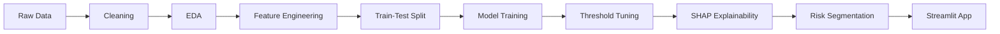

<div align="center">

# 🏦 Bank Customer Churn Prediction

### End-to-end machine learning project: from raw data to a deployed web app


[](https://YOUR-APP-LINK.streamlit.app)

</div>

---

## 📑 Table of Contents

- [Overview](#-overview)
- [Highlights](#-highlights)
- [Dataset](#-dataset)
- [Key Findings](#-key-findings)
- [Project Pipeline](#-project-pipeline)
- [Model Results](#-model-results)
- [Business Impact](#-business-impact)
- [Web App](#-web-app)
- [Project Structure](#-project-structure)
- [Run Locally](#-run-locally)
- [Tech Stack](#-tech-stack)
- [Limitations](#-limitations)
- [Author](#-author)

---

## 🎯 Overview

Losing customers is expensive for a bank, and winning new ones costs far more than keeping existing ones. This project builds a machine learning model that **predicts which customers are likely to leave**, groups them into **Low, Medium and High risk** levels, and serves the results in an **interactive Streamlit web app**.

The goal is simple: help a bank spend its retention budget on the customers who need it most, instead of contacting everyone.

---

## ✨ Highlights

| Metric | Result |
|:---|:---:|
| Best model | **Random Forest** (class weights + threshold tuning) |
| ROC-AUC | **0.855** |
| Recall (churners caught) | **66%** |
| Precision | **57%** |
| F1 score | **0.61** |
| High-risk group real churn rate | **88%** |

---

## 📊 Dataset

- **Source:** public Churn Modelling dataset
- **Size:** 10,000 bank customers, 14 columns
- **Target:** `Exited` (1 = customer left, 0 = stayed)
- **Class balance:** about 20.4% churned, so the data is imbalanced
- **Quality:** no missing values and no duplicate rows

---

## 🔍 Key Findings

| Factor | What the data shows |
|:---|:---|
| **Age** | Churn rises from 7.5% (ages 18-30) to 34% (41-50) and 56% (51-60) |
| **Number of products** | 3 products: about 83% churn. 4 products: 100% churn. 2 products: only about 8% |
| **Country** | Germany churns at about 32%, double France (16%) and Spain (17%) |
| **Activity** | Inactive members churn at about 27%, against 14% for active members |
| **Gender** | Female customers churn at about 25%, male customers at about 16% |

---

## 🧭 Project Pipeline



1. **Data cleaning:** dropped ID columns (`RowNumber`, `CustomerId`, `Surname`) that carry no signal.
2. **Exploratory data analysis:** churn rate by country, gender, age group, number of products and activity status.
3. **Feature engineering:** `BalanceSalaryRatio`, `ProductsPerTenure`, `ZeroBalance` flag and age groups, plus one-hot encoding for country and gender.
4. **Train-test split:** stratified 80/20 split so both sets keep the same churn rate.
5. **Modelling:** Logistic Regression as a baseline, then Random Forest.
6. **Imbalance handling:** class weights in the Random Forest.
7. **Threshold tuning:** lowered the decision threshold from 0.50 to 0.30 to catch more churners, because missing a churner costs more than a wasted retention offer.
8. **Explainability:** feature importance and SHAP values. Age, number of products and balance-related features rank highest.
9. **Risk segmentation:** Low, Medium and High risk groups.
10. **Deployment:** Streamlit app with a gauge chart, risk card and data insights.

---

## 🤖 Model Results

| Model | Accuracy | Precision | Recall | F1 | ROC-AUC |
|:---|:---:|:---:|:---:|:---:|:---:|
| Logistic Regression | 0.808 | 0.595 | 0.184 | 0.281 | 0.774 |
| Random Forest | 0.869 | 0.813 | 0.459 | 0.587 | 0.853 |
| **Random Forest + class weights + threshold 0.30** | n/a | 0.572 | **0.656** | **0.611** | **0.855** |

> **Note:** accuracy alone is misleading here. A model that predicts "no churn" for every customer already scores about 80%, so recall, precision, F1 and ROC-AUC are used instead.

### Threshold trade-off

| Threshold | Precision | Recall | F1 |
|:---:|:---:|:---:|:---:|
| 0.50 | 0.807 | 0.452 | 0.580 |
| 0.40 | 0.686 | 0.536 | 0.601 |
| **0.30** | **0.572** | **0.656** | **0.611** |
| 0.25 | 0.512 | 0.722 | 0.599 |

---

## 💼 Business Impact

Customers in the test set (2,000 customers) were grouped by predicted churn probability:

| Risk level | Customers | Real churn rate |
|:---|:---:|:---:|
| 🟢 Low (below 30%) | 1,544 | 9% |
| 🟠 Medium (30-60%) | 296 | 42% |
| 🔴 High (above 60%) | 160 | 88% |

Targeting only the **467 Medium and High risk customers** reaches **267 of the 407 customers who actually left**, so the bank can focus its retention budget on about 23% of customers instead of all of them.

### Recommended retention actions

- Personal outreach and special offers for High-risk customers
- Loyalty benefits for customers aged 41-60
- Investigate why churn in Germany is double that of other countries
- Review product bundles, since customers with 3-4 products almost always leave
- Re-engagement campaigns for inactive members

---

## 🖥️ Web App

The Streamlit app lets a user enter customer details and instantly see:

- A **gauge chart** showing the churn probability
- A colour-coded **risk card** (Low, Medium or High) with recommended action
- **Key factors** explaining the result in plain language
- A **Data Insights** tab with interactive charts from the analysis


---

## 📁 Project Structure

```
bank-customer-churn-prediction/
├── data/
│   └── Churn_Modelling.csv
├── notebooks/
│   └── churn_analysis.ipynb
├── app/
│   ├── app.py
│   ├── requirements.txt
│   ├── churn_model.pkl
│   └── model_columns.pkl
└── README.md
```

---

## 🚀 Run Locally

```bash
git clone https://github.com/Japkirat7007/bank-customer-churn-prediction.git
cd bank-customer-churn-prediction/app
pip install -r requirements.txt
streamlit run app.py
```

The app opens in your browser at `http://localhost:8501`.

---

## 🛠️ Tech Stack

| Area | Tools |
|:---|:---|
| Language | Python |
| Data analysis | pandas, NumPy |
| Machine learning | scikit-learn |
| Explainability | SHAP |
| Visualisation | Matplotlib, Plotly |
| Web app | Streamlit |
| Model saving | Joblib |

---

## ⚠️ Limitations

- The dataset is a public snapshot with no dates or transaction history, so time-based analysis is not possible.
- It appears to be synthetic, so the findings should not be treated as real-world banking conclusions.
- Account balance is used as a simple stand-in for customer value.
- The "key factors" shown in the app are rules based on the data analysis, not per-customer model explanations.

---

## 👤 Author

**JAPKIRAT KAUR**
B.Tech Computer Science and Engineering

---

<div align="center">

If you found this project useful, please consider giving it a ⭐

</div>
